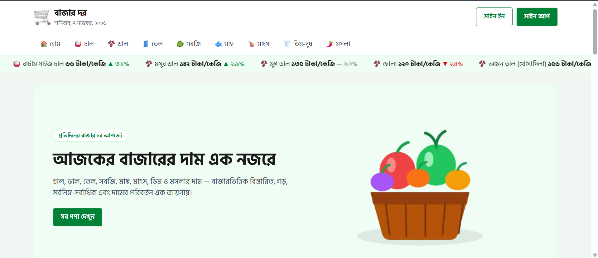
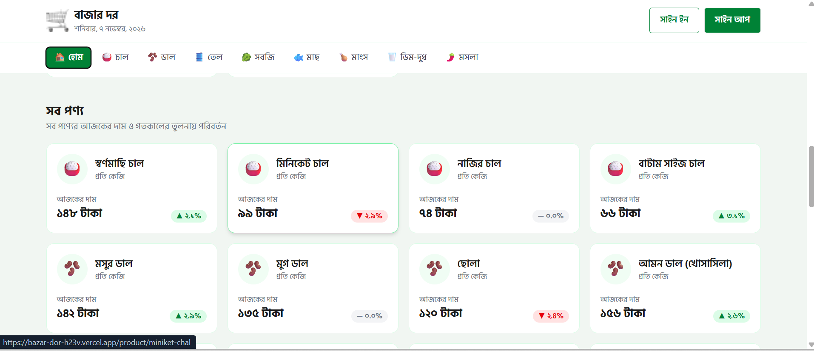
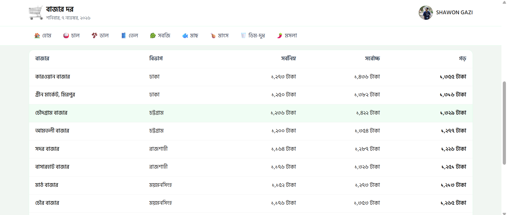
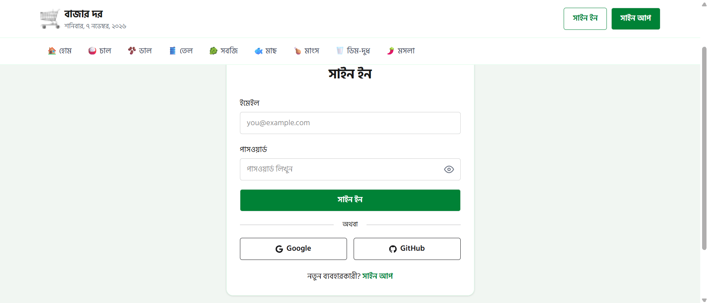
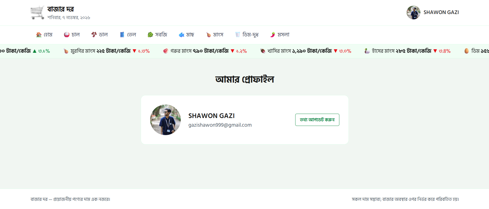

# 🛒 বাজার দর (BazarDor)

> **প্রয়োজনীয় পণ্যের দৈনিক বাজার দর এক নজরে!**

**বাজার দর (BazarDor)** হলো একটি আধুনিক ও responsive web application, যেখানে বাংলাদেশের নিত্যপ্রয়োজনীয় পণ্যের দৈনিক বাজারমূল্য সহজেই দেখা ও তুলনা করা যায়।

চাল, ডাল, তেল, সবজি, মাছ, মাংস, ডিম, দুধ ও মসলাসহ বিভিন্ন পণ্যের বর্তমান দাম, আগের দিনের তুলনায় মূল্য পরিবর্তন এবং বিভিন্ন বাজারের দামের তুলনা এই প্ল্যাটফর্মে পাওয়া যায়।

আমাদের লক্ষ্য হলো ব্যবহারকারীদের বাজারমূল্য সম্পর্কে সহজ, সুন্দর এবং তথ্যবহুল অভিজ্ঞতা প্রদান করা।

### 🔗 Important Links

- 🌐 **Live Website:** [https://bazar-dor-h23v.vercel.app/](https://bazar-dor-h23v.vercel.app/)
- 💻 **GitHub Repository:** [https://github.com/gazishawon999/bazar-dor](https://github.com/gazishawon999/bazar-dor)

---

## 📸 Project Preview

### 🏠 Homepage



### 🛍️ Products Page



### 📊 Product Details Page



### 🔐 Authentication Page



### 👤 User Profile Page



## ✨ Key Features

### 1. 🏠 Interactive Homepage

- সুন্দর ও user-friendly homepage design
- Responsive navbar with category navigation
- Bengali date display
- Hero banner with a call-to-action button
- সহজেই সব পণ্যের section-এ যাওয়ার সুবিধা

### 2. 📊 Daily Price Tracker

- Real-time API থেকে পণ্যের তথ্য সংগ্রহ
- আজ দাম বেড়েছে এমন Top 6 Products
- আজ দাম কমেছে এমন Top 6 Products
- Price change percentage with visual indicators
- Infinite scrolling price ticker

### 3. 🛍️ Product Management and Details

- বিভিন্ন category-এর সব পণ্যের তালিকা
- প্রতিটি পণ্যের জন্য আলাদা details page
- Product name, category এবং unit information
- Minimum, Maximum এবং Average price summary
- বিভিন্ন বাজারের পণ্যমূল্য তুলনা করার সুবিধা

### 4. 📂 Category and Sorting

- Category অনুযায়ী পণ্য filter
- Default sorting
- Price: Low to High sorting
- Price: High to Low sorting
- Bengali numerals সঠিকভাবে numeric sorting
- Loading skeleton এবং empty state handling

### 5. 🔐 Authentication System

- BetterAuth authentication integration
- Email এবং Password দিয়ে Sign In ও Sign Up
- Google authentication
- GitHub authentication
- Protected routes for authenticated users
- Login, Registration এবং Logout notifications
- Authentication validation এবং error handling

### 6. 👤 User Profile Management

- User profile information দেখা
- Profile name update করার সুবিধা
- Dedicated Update Information page
- BetterAuth user information update integration

### 7. 📱 Fully Responsive Design

- Mobile, Tablet এবং Desktop support
- Responsive product grid
- Mobile-friendly navigation
- Responsive hero section এবং product cards
- বিভিন্ন screen size-এ consistent user experience

### 8. ⚡ Better User Experience

- Loading skeleton animations
- React Hot Toast notifications
- Custom 404 page
- Invalid category এবং product route handling
- Page refresh এবং direct route navigation support

---

## 🛠️ Technologies Used

| Technology           | Purpose                       |
| -------------------- | ----------------------------- |
| Next.js              | Frontend framework            |
| Next.js App Router   | Application routing           |
| TypeScript           | Type safety                   |
| Tailwind CSS         | Styling and responsive design |
| DaisyUI              | UI components                 |
| BetterAuth           | Authentication                |
| MongoDB Atlas        | Database                      |
| React Hot Toast      | Toast notifications           |
| React Icons          | Icons and visual elements     |
| Programming Hero API | Product and category data     |
| Vercel               | Deployment and hosting        |

---

## 🌐 API Documentation

This project uses the **Programming Hero BazarDor API** to retrieve product and category information.

### Alternative API URL

```text
https://api.api-store.workers.dev/api/bazardor
```

### API Features

The API provides data for:

- All products
- Products by category
- Single product details
- All categories
- Single category details
- Product prices from different markets

> **Note:** Check the application source code for the exact endpoint paths used in the current implementation.

---

## 🚀 Getting Started

Follow these steps to run the project on your local machine.

### Prerequisites

Make sure the following tools and services are available:

- Node.js, preferably the LTS version
- npm
- Git
- MongoDB Atlas account
- Google OAuth credentials, if using Google login
- GitHub OAuth credentials, if using GitHub login

---

### 1. Clone the Repository

```bash
git clone https://github.com/gazishawon999/bazar-dor.git
```

### 2. Navigate to the Project Directory

```bash
cd bazar-dor
```

### 3. Install Dependencies

```bash
npm install
```

### 4. Configure Environment Variables

Create a `.env.local` file in the root directory of the project.

```env
DATABASE_URL=your_mongodb_connection_string

BETTER_AUTH_SECRET=your_secret_key
BETTER_AUTH_URL=http://localhost:3000

GOOGLE_CLIENT_ID=your_google_client_id
GOOGLE_CLIENT_SECRET=your_google_client_secret

GITHUB_CLIENT_ID=your_github_client_id
GITHUB_CLIENT_SECRET=your_github_client_secret
```

> **Important:** The exact environment variable names may differ dependingit your `.env.local` file or expose secret credentials publicly.

### 5. Run the Development Server

```bash
npm run dev
```

Open the following address in your browser:

```text
http://localhost:3000
```

---

## 📁 Project Structure

A simplified overview of the **BazarDor** project structure:

```text
bazar-dor/
│
├── public/
│   ├── file.svg
│   ├── globe.svg
│   ├── next.svg
│   ├── vercel.svg
│   └── window.svg
│
├── src/
│   ├── app/
│   │   ├── api/
│   │   │   └── auth/
│   │   │       └── [...all]/
│   │   │
│   │   ├── category/
│   │   ├── product/
│   │   ├── profile/
│   │   ├── signin/
│   │   ├── signup/
│   │   │
│   │   ├── error.tsx
│   │   ├── favicon.ico
│   │   ├── globals.css
│   │   ├── layout.tsx
│   │   ├── not-found.tsx
│   │   └── page.tsx
│   │
│   ├── components/
│   ├── img/
│   └── lib/
│
├── .env
├── .gitignore
├── AGENTS.md
├── eslint.config.mjs
├── next-env.d.ts
├── next.config.ts
├── package-lock.json
├── package.json
├── README.md
└── tsconfig.json
```

> **Note:** The `.next` and `node_modules` directories are generated automatically and are not included in the GitHub repository. The `.env` file contains sensitive environment variables and must also remain excluded through `.gitignore`.

> **Note:** This is a representative project structure. The actual folders and filenames may vary depending on the current implementation.

---

## 🚢 Deployment

The application is deployed using **Vercel**.

### Live Application

🌐 [Visit BazarDor](https://bazar-dor-h23v.vercel.app/)

### Deploy Your Own Version

1. Push the project to a GitHub repository.
2. Sign in to Vercel.
3. Import the GitHub repository into Vercel.
4. Configure the required environment variables.
5. Connect the MongoDB Atlas database.
6. Configure Google and GitHub OAuth callback URLs.
7. Deploy the application.

---

## ⚠️ Disclaimer

সকল পণ্যের দাম সম্ভাব্য এবং বাজার পরিস্থিতি, স্থান ও সময় অনুযায়ী পরিবর্তিত হতে পারে। এই ওয়েবসাইটে প্রদর্শিত মূল্য শুধুমাত্র তথ্যগত ও শিক্ষামূলক উদ্দেশ্যে প্রদান করা হয়েছে।

কোনো পণ্য কেনার আগে আপনার স্থানীয় বাজারে বর্তমান মূল্য যাচাই করার পরামর্শ দেওয়া হচ্ছে।

---

## 👨‍💻 Developer

**Shawon Gazi**

- 🌐 **Live Website:** [https://bazar-dor-h23v.vercel.app/](https://bazar-dor-h23v.vercel.app/)
- 💻 **GitHub Repository:** [https://github.com/gazishawon999/bazar-dor](https://github.com/gazishawon999/bazar-dor)
- ℹ️ **Linkedln:** [https://www.linkedin.com/in/gazishawon999](https://www.linkedin.com/in/gazishawon999)

---

<div align="center">

## 🛒 বাজার দর

### প্রয়োজনীয় পণ্যের দাম এক নজরে

Made with ❤️ using **Next.js, TypeScript, Tailwind CSS and MongoDB Atlas**

If you find this project helpful, please consider giving it a ⭐ on GitHub.

</div>
